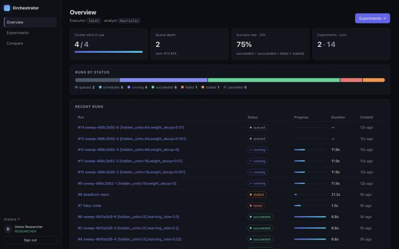
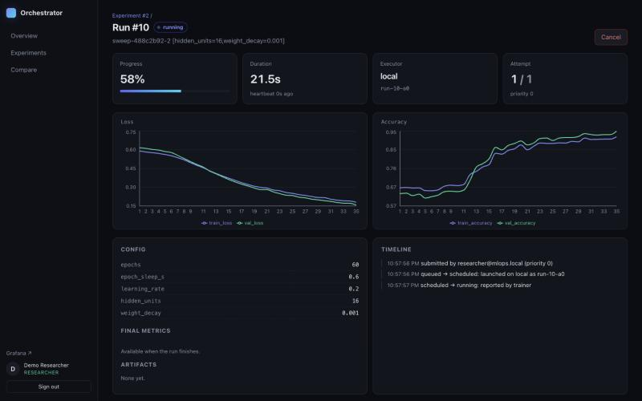
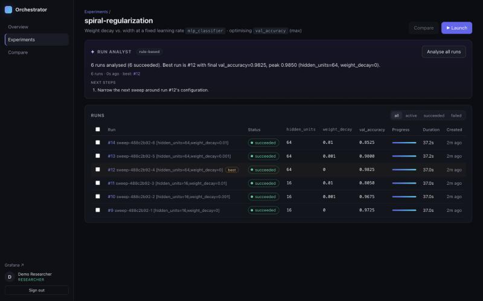
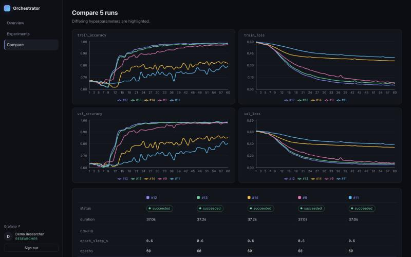
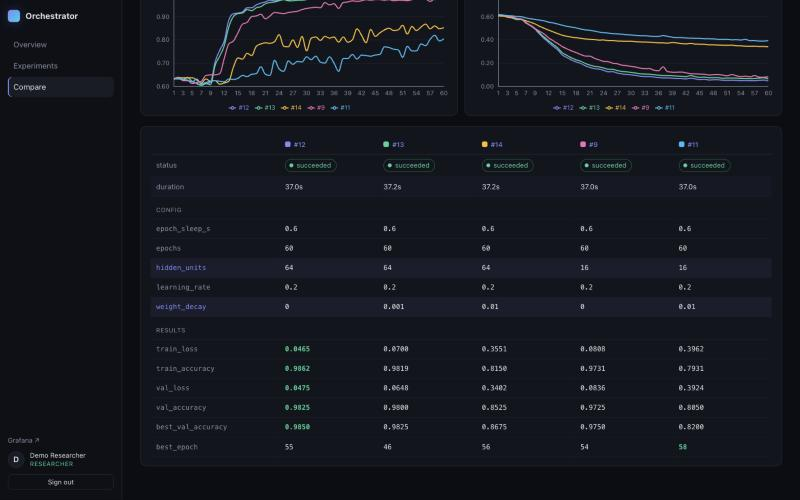
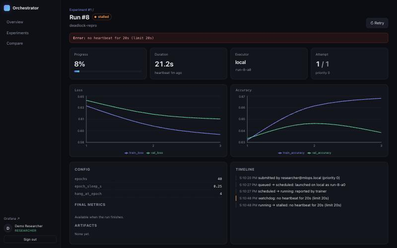

# ML Experiment & Job Orchestration Platform

Schedule, monitor and compare ML training runs. Training jobs go through a Redis-backed
priority queue and a dispatcher that launches each one as a **Kubernetes Job** (or a local
subprocess in dev). Every run's config, per-epoch metrics, artifacts and state transitions
are stored in **PostgreSQL**. A **React/Redux** dashboard shows live progress and side-by-side
comparisons. **Prometheus/Grafana** alerts fire on failed or stalled jobs. An **LLM analyst**
(Claude) summarises results and flags anomalies.

**Stack:** Python · FastAPI · SQLAlchemy · PostgreSQL · Redis · Kubernetes · React · Redux Toolkit · Recharts · Prometheus · Grafana · Docker · GitHub Actions · Claude API

## Screenshots

| | |
|---|---|
|  |  |
| **Overview** — slot usage, queue depth, success rate, runs by status | **Live run** — metrics stream in while the job trains |
|  |  |
| **Experiment** — sweep results, best run, analyst summary | **Compare** — curves from several runs overlaid |
|  |  |
| **Compare table** — differing hyperparameters highlighted, winners in green | **Stalled run** — heartbeats stopped, watchdog killed the job |

```
                ┌─────────────── React / Redux dashboard ───────────────┐
                │  overview · experiments · live run view · compare     │
                └───────────────────────────┬───────────────────────────┘
                                            │ JWT (admin / researcher / viewer)
┌───────────────────────────────────────────▼─────────────────────────────────────┐
│ FastAPI   /api/experiments  /api/runs  /api/auth  /metrics                      │
│           /api/internal/runs/{id}/{status|metrics|heartbeat|artifacts}          │
│                     ▲ per-run JWT: a pod can only report on its own run          │
└───────┬─────────────┼──────────────────────────┬────────────────────────────────┘
        │ enqueue      │ callbacks                │ SQLAlchemy
        ▼              │                          ▼
   Redis ZSET ──► Dispatcher (leader-elected)  PostgreSQL
   priority queue    reconcile · watchdog ·     users, experiments, runs,
                     dispatch · gauges          metric_points, artifacts,
                         │                      run_events, analyses
                         ▼ batch/v1 Job per attempt
                 Kubernetes  ──► trainer pod (numpy MLP) ──► /artifacts PVC
                         │
             Prometheus ◄┘ scrape  ──► alert rules ──► Grafana dashboard
```

## Features

| Area | What it does |
|---|---|
| **Scheduling** | Priority queue (Redis sorted set + `ZPOPMIN`, FIFO within a priority). Capacity limit on concurrent runs. Grid sweeps expand into individual runs sharing a `sweep_id`. |
| **Execution** | `KubernetesExecutor` creates one `batch/v1` Job per attempt, with CPU/memory/GPU requests, a non-root security context, a shared artifact PVC and a TTL. `LocalExecutor` runs the same trainer as a subprocess for dev and CI. |
| **Reliability** | The dispatcher **reconciles** DB state against the executor (crash, `ImagePullBackOff`, exit without reporting). A **watchdog** marks runs `stalled` when heartbeats stop and kills the pod. **Automatic retries** per run (`max_retries`), plus manual retry and cancel. A Redis **leader lock** makes several dispatcher replicas safe to run. |
| **Tracking** | Per-epoch metrics, final summary, config, artifacts (path, size, sha256), and a full event timeline for each run. |
| **Dashboard** | Live cluster utilisation and queue depth, an experiment run table with differing hyperparameters as columns, a run page with live loss/accuracy charts, logs, timeline and artifact downloads, and a **compare view** that overlays curves and highlights config differences and the best result. |
| **Monitoring** | Counters, gauges and histograms at `/metrics`. Alert rules: `TrainingRunStalled`, `HeartbeatLagging`, `TrainingFailureSpike`, `HighFailureRatio`, `QueueNotDraining`, `DispatcherDown`, `DispatchErrors`. Grafana dashboard is provisioned automatically. |
| **Auth** | JWT bearer tokens. Roles: `viewer` (read-only), `researcher` (create experiments, launch/cancel/retry own runs), `admin` (manage users and any run). Training pods get a separate **run-scoped token**. |
| **LLM analyst** | Rule-based detectors always run: NaN or diverging loss, overfitting gap, validation-loss rebound, plateaus, stalls, crashes and slow outliers. With `ANTHROPIC_API_KEY` set, Claude (`claude-opus-5-5`, JSON-schema output) writes the summary, picks the best run and adds recommendations. If the API call fails, the rule-based report is used. |
| **CI/CD** | GitHub Actions runs ruff, pytest (real dispatcher plus subprocess trainer), vitest, the Vite build, kubeconform, `promtool check rules`, image builds, and a kind deploy smoke test on `main`. |

## Quick start (no Docker needed)

Uses SQLite, an in-memory queue and the subprocess executor.

```bash
python3 -m venv .venv && .venv/bin/pip install -r backend/requirements-dev.txt
cd backend && ../.venv/bin/uvicorn app.main:app --port 8000
```

```bash
cd frontend && npm install && npm run dev
```

Open http://localhost:5173. Demo accounts: `admin@mlops.local / admin123`,
`researcher@mlops.local / research123`, `viewer@mlops.local / viewer123`.

Things to try:
- Create an experiment, then **Launch → Grid sweep** with `learning_rate = 0.01, 0.1, 1.5` and `hidden_units = 4, 32`.
- Add `{"fail_at_epoch": 5}` with `max_retries: 1` to watch the automatic retry, or `{"hang_at_epoch": 5}` to watch the stall watchdog.
- Select a few runs → **Compare**, then **Analyse** (set `ANTHROPIC_API_KEY` to get Claude's write-up).

## Full stack with Docker Compose

```bash
docker compose up --build
```

Dashboard on :8080, API on :8000, Prometheus on :9090, Grafana on :3000.

## On Kubernetes (kind)

```bash
make k8s-up        # builds images, creates the kind cluster, loads images, applies deploy/k8s
make port-forward  # dashboard :8080, grafana :3000, prometheus :9090
kubectl -n mlops get jobs,pods -l app.kubernetes.io/name=mlops-trainer -w
```

The API and dispatcher run under a `mlops-controller` ServiceAccount. Its namespaced Role can
only create, read and delete Jobs and read pods and logs.

## Configuration

All settings are environment variables. See `backend/app/config.py`.

| Variable | Default | |
|---|---|---|
| `DATABASE_URL` | SQLite in `.data/` | `postgresql+psycopg2://…` in compose/k8s |
| `QUEUE_URL` | `memory://` | `redis://host:6379/0` |
| `EXECUTOR` | `local` | `kubernetes` |
| `MAX_CONCURRENT_RUNS` | 4 | Cluster slots |
| `STALL_TIMEOUT_S` | 60 | Heartbeat silence before a run is marked stalled (5× for pods still starting) |
| `EMBEDDED_WORKER` | true | Run the dispatcher inside the API (dev), or run `python -m app.worker` |
| `JWT_SECRET` | dev value | **Set this in any real deployment** |
| `ANALYST_MODE` | `auto` | `auto` uses Claude when `ANTHROPIC_API_KEY` is set; `heuristic` never calls the API |

## Tests

```bash
make test
```

The backend suite runs real trainer subprocesses against a live callback server. It covers the
success path with metrics and artifacts, injected failure with auto-retry, the hang-to-stall
watchdog, cancel and requeue, sweeps, compare, analysis, RBAC, run-token isolation, Prometheus
output and the Kubernetes Job manifest.

## Layout

```
backend/app/
  main.py          FastAPI app, /metrics
  dispatcher.py    reconcile → watchdog → dispatch → gauges loop
  job_queue.py     Redis / in-memory priority queue + leader lock
  executors/       local.py (subprocess), kubernetes.py (batch/v1 Job)
  services.py      run state machine, retries, sweeps
  analyst.py       anomaly detectors + Claude summary
  auth.py          JWT, RBAC, run tokens
  routers/         auth, experiments, runs, internal (trainer callbacks), system
trainer/train.py   the containerised training job (numpy MLP on a spirals dataset)
frontend/src/      React + Redux Toolkit dashboard
deploy/            k8s manifests, Prometheus rules, Grafana provisioning
```
